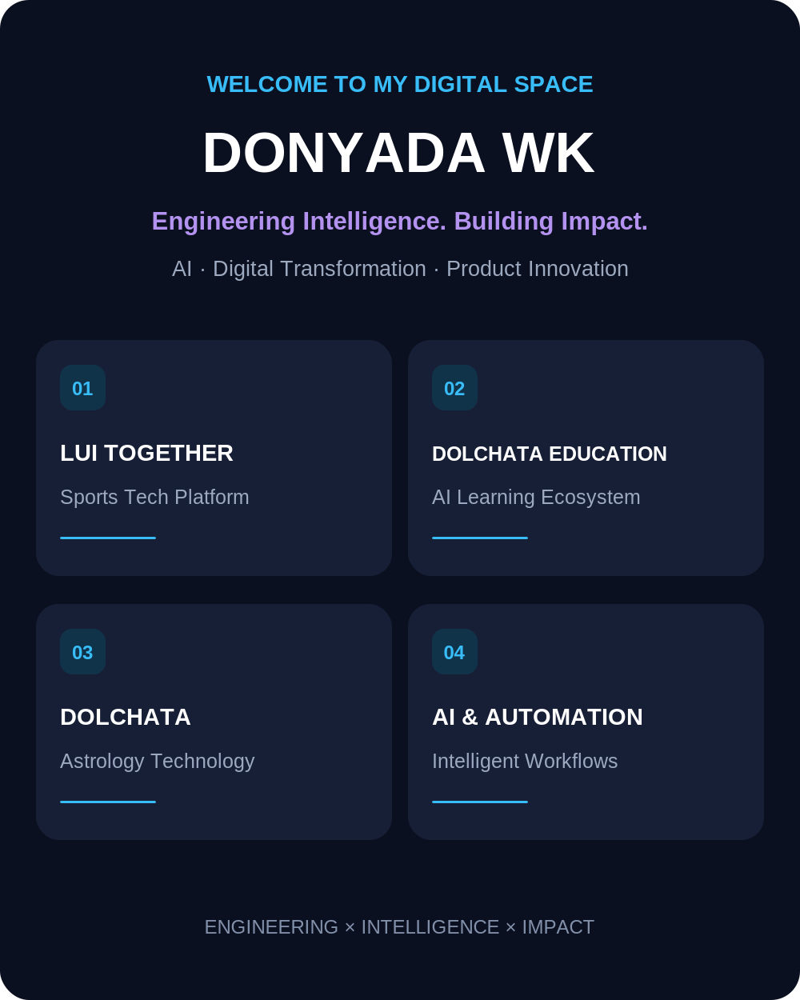

# Donyada Weankhuntod (Fern)
### Senior Engineering Experience · AI Applications · Digital Transformation

**Engineering systems. Translating complexity. Building lasting impact.**

[Portfolio](https://github.com/DonyadaWK) · [DOLCHATA](https://dolchata.com/) · [LUI Together](https://luitogether.com/) · [DOLCHATA Education](https://dolchataeducation.com/)

## Professional Profile

Control Engineering graduate from King Mongkut's Institute of Technology Ladkrabang (KMITL), First-Class Honors and Academic Gold Medal. Former Process Control Technology Engineer and Energy Engineer at Covestro Thailand, with experience in energy performance and cost analysis, regulatory alignment, industrial digitalization and cross-functional implementation.

My work connects **engineering, operations, management, regulations and technology**—from understanding a system and defining requirements to implementation, knowledge transfer and long-term ownership. I am expanding this foundation through applied AI, automation and digital product development.

## Selected Professional Case Studies

| Area | Experience and contribution |
|---|---|
| **Energy analytics & cost** | Analyzed electricity, steam, fuel and energy cost per unit of production; supported data-based energy decisions. |
| **ISO 50001 & compliance** | Led the transition from ISO 50001:2011 to 2018, including energy performance normalization, EnPIs/EnBs, audit readiness and Thai regulatory alignment. |
| **Digital government interface** | Led an industrial-side DEDE e-service / e-form initiative, coordinating process requirements, stakeholders and implementation. |
| **Process control** | Supported Advanced Process Control improvements after training in Germany; initiated cross-site knowledge sharing. |
| **Operational governance** | Worked on alarm management, HMI and global directive alignment, including local regulatory requirements. |
| **AI & digital transformation** | Completed Covestro Global AI Academy; explored practical AI-enabled energy and ESG workflows. |

These are **high-level professional summaries**, not published employer source code or confidential operating data.

## Products and Ventures

### [DOLCHATA](https://dolchata.com/)
Astrology, structured knowledge and digital experiences. **Website live; development ongoing.**

### [DOLCHATA Education Together](https://dolchataeducation.com/)
Education pathways, examination preparation and learning analytics. **Product development ongoing.** [Project repository](https://github.com/DonyadaWK/dolchata-education)

### [LUI Together](https://luitogether.com/)
Sports events, athlete experiences and community technology. **Product development ongoing.** [Project repository](https://github.com/DonyadaWK/luitogether)

## Engineering and Product Practices

- **Analyze:** Business process mapping, energy cost analysis, data quality, regulatory requirements and stakeholder needs.
- **Design:** Requirements, workflows, operating procedures, dashboards and measurement frameworks.
- **Deliver:** Cross-functional coordination, implementation planning, change management and knowledge transfer.
- **Improve:** User feedback, process pain points, automation opportunities and continuous improvement.

## Portfolio Documentation

- [Professional case studies](./portfolio/CASE_STUDIES.md)
- [Engineering and AI portfolio](./portfolio/ENGINEERING_AI.md)
- [Portfolio project governance](./PROJECT_GOVERNANCE.md)

> Product roadmaps are not claims of completed functionality. Public repositories may contain documentation only; production code, customer data and employer-confidential material are not published here.

**THINK → DESIGN → BUILD → TRANSFER → IMPACT**

